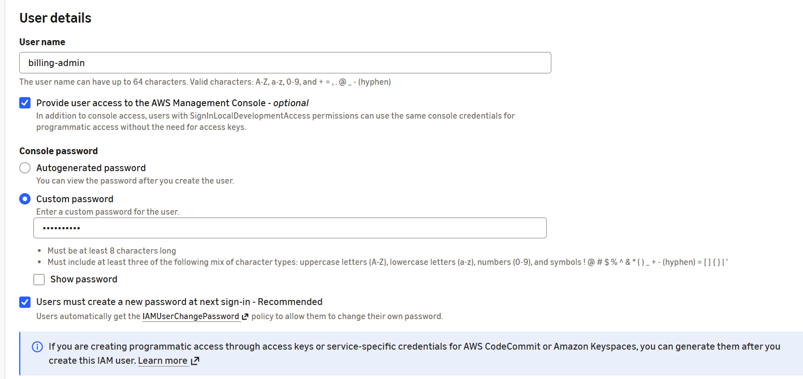
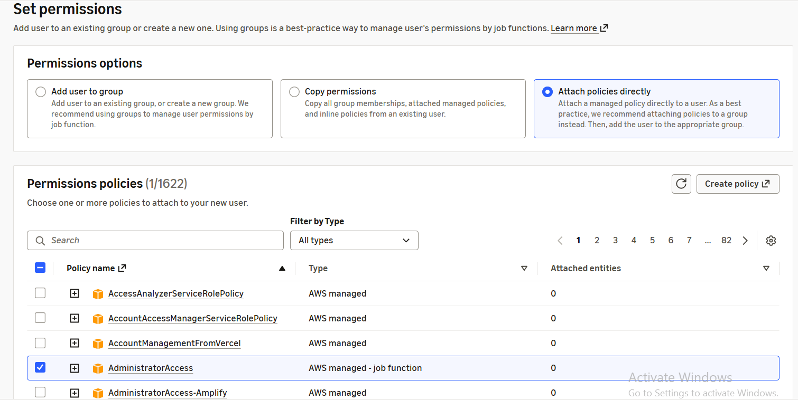
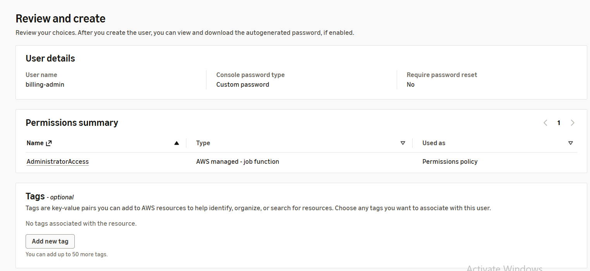
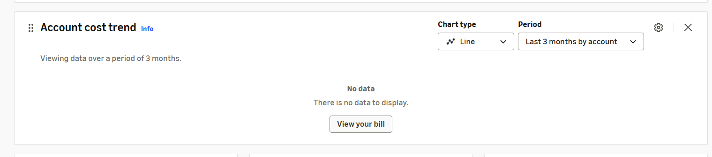
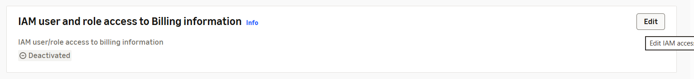
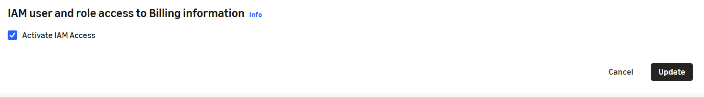
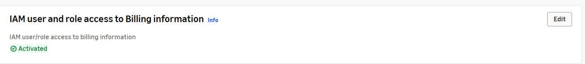
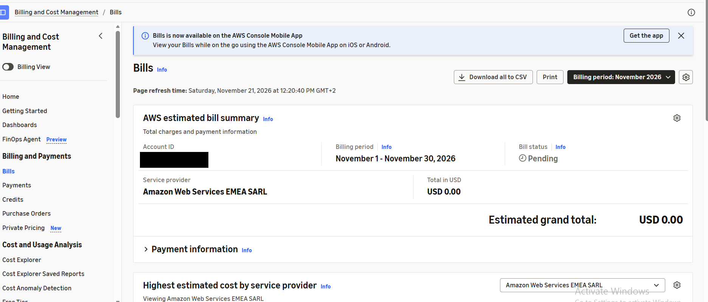
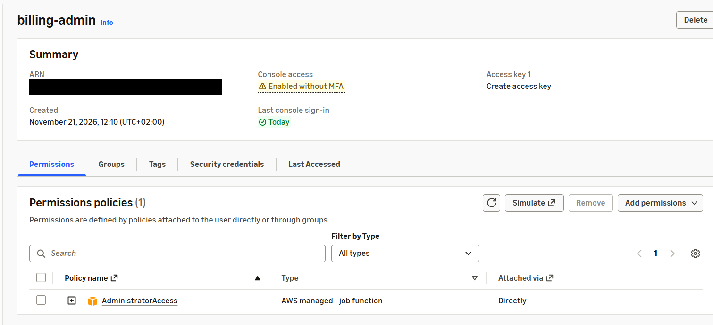

# Lab 01 — AWS IAM Administrator & Billing Access

**Topic:** Identity and Access Management (IAM) · Billing and Cost Management  
**Platform:** Amazon Web Services (AWS)  
**Lab type:** Hands-on configuration and validation

## Overview

This lab demonstrates how to create an AWS IAM user with AWS Management Console access, attach the AWS-managed `AdministratorAccess` policy, and enable IAM access to billing information. The lab concludes by verifying that the user can access the AWS Bills page.

> **Important:** An IAM administrator is **not** the AWS account root user. Some account-level operations remain root-only. Administrator privileges should be granted only when necessary.

## Objectives

- Create an IAM user with console sign-in enabled.
- Assign the AWS-managed `AdministratorAccess` policy.
- Enable **IAM user and role access to Billing information** from the root account.
- Verify access to the AWS Bills page while signed in as the IAM user.
- Review basic security safeguards for privileged identities.

## Services and Concepts

| Service / concept | Role in this lab |
| --- | --- |
| AWS IAM | Creates the user and manages its permissions |
| AWS Management Console | Provides interactive access to AWS services |
| `AdministratorAccess` | Grants broad administrative permissions, subject to account-level restrictions |
| AWS Billing and Cost Management | Displays bills and account cost information |
| Root user | Enables the account-level IAM billing access setting |

## High-Level Access Flow

```text
AWS Root User
    │
    ├── Enables IAM access to Billing information
    │
    └── Creates / manages IAM administrator
                │
                ├── Console sign-in
                ├── AdministratorAccess policy
                └── AWS Billing → Bills (verified)
```

## Implementation

### Step 1 — Configure the IAM user

In **IAM → Users → Create user**, enter the user name, enable AWS Management Console access, and configure a console password. The screenshot shows the example user `billing-admin`.



### Step 2 — Attach administrative permissions

Under **Set permissions**, select **Attach policies directly** and choose the AWS-managed **`AdministratorAccess`** policy.



### Step 3 — Review the configuration

Review the IAM user details and attached permissions before creating the user. The review screenshot confirms `AdministratorAccess` was selected.



### Step 4 — Inspect billing cost information

Open **Billing and Cost Management**. The cost-trend widget in the screenshot shows **No data** for the selected period. This alone does **not** mean billing access is denied.



### Step 5 — Enable IAM billing access from the root account

Navigate to **Account → IAM user and role access to Billing information**. Initially, the setting was **Deactivated**.



Select **Edit**, check **Activate IAM Access**, and save using **Update**.



The account setting then displays **Activated**.



### Step 6 — Validate billing access

Sign in as the IAM user and open **Billing and Cost Management → Bills**. The screenshot confirms the Bills page loads and displays an estimated bill summary for November 2026. The displayed estimate was **USD 0.00**, with a **Pending** billing status at the time of capture.



### Step 7 — Verify the attached policy

In **IAM → Users → billing-admin → Permissions**, confirm that **`AdministratorAccess`** is directly attached. The screenshot also shows console access enabled.



## Verification and Results

| Check | Observed result |
| --- | --- |
| IAM user created | Confirmed |
| AWS Console access | Enabled |
| `AdministratorAccess` attached | Confirmed |
| Account-level IAM billing access | Activated |
| IAM user can open Bills | Confirmed |
| Root-equivalent identity | No — IAM user remains distinct from root |
| MFA on IAM user | **Not enabled in the captured verification screen** |

## Security Considerations

- **Enable MFA immediately** for privileged IAM users. The final screenshot indicates console access without MFA.
- **Apply least privilege:** `AdministratorAccess` is suitable for a controlled admin lab but is broader than necessary for a billing-only role.
- **Protect the root account:** enable root MFA, avoid sharing root credentials, and reserve root sign-in for root-only tasks.
- **Avoid exposing secrets:** never commit passwords, access keys, session tokens, or recovery codes to GitHub.
- **Review screenshots before publishing:** redact account identifiers and other details you do not want publicly visible.
- **Billing activation is an access setting, not a billing-service on/off switch.** It permits IAM identities with appropriate policies to access billing information.

## Key Takeaways

This lab demonstrates the separation between **identity permissions** and **account-level billing access settings**. Attaching `AdministratorAccess` alone does not replace the root-controlled billing access configuration. After both were configured, the IAM administrator could open the Bills page successfully.

## Evidence

All nine screenshots are available in the [`screenshots/`](screenshots/) directory and are embedded alongside the corresponding steps above.
