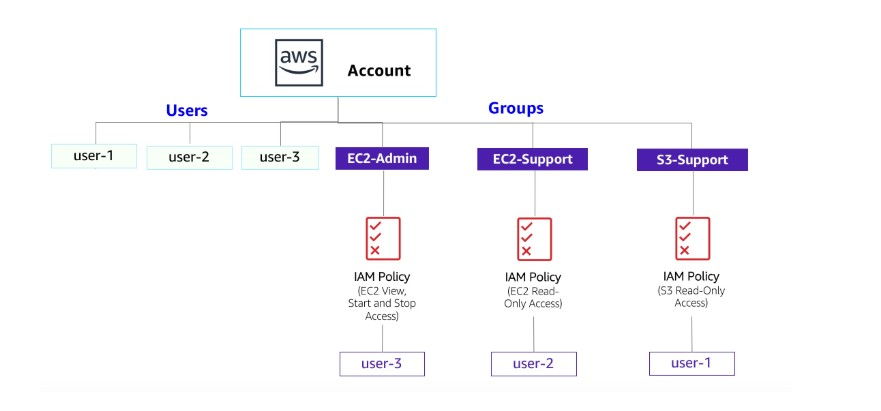

# Lab 02 — AWS IAM Users, Groups, and Access Control

## Objective

Assign IAM users to groups and verify that each group grants only the access needed for its lab role. The EC2 tests compare a denied stop request from the support user with a successful stop request from the EC2 admin user.

## Users, groups, and policies

| IAM user | Group | Lab permissions |
| --- | --- | --- |
| `user-1` | `S3-Support` | Read-only access to Amazon S3 |
| `user-2` | `EC2-Support` | Read-only access to Amazon EC2 |
| `user-3` | `EC2-Admin` | View, start, and stop the lab's EC2 instances |

The support groups use managed read-only policies. The **EC2-Admin** group uses an inline policy for the EC2 actions in the lab. Managed policies can be attached to multiple identities. An inline policy is embedded in a single user, group, or role.

## Configure and inspect group membership

1. Open **IAM → User groups** and review the three preconfigured groups and their policies.
2. Add `user-1` to **S3-Support**, `user-2` to **EC2-Support**, and `user-3` to **EC2-Admin**. Confirm membership on each group's **Users** tab.
3. Open the IAM sign-in page in a private browser window. Sign in with the lab-provided credentials and switch users between tests.

[Group list](screenshots/01-iam-groups.jpg) · [Add user](screenshots/02-add-user-to-group.jpg) · [S3-Support membership](screenshots/03-s3-support-membership.jpg) · [EC2-Support membership](screenshots/04-ec2-support-membership.jpg) · [IAM sign-in](screenshots/05-iam-sign-in.jpg) · [IAM dashboard](screenshots/06-iam-dashboard.jpg)

## Verify permissions

| Test | Expected result | Evidence |
| --- | --- | --- |
| Open Amazon S3 as `user-1` | Read-only access | [Group membership](screenshots/03-s3-support-membership.jpg) |
| View EC2 instances as `user-2` in N. Virginia | Instances are visible | [EC2 stop dialog](screenshots/08-stop-instance-attempt.jpg) |
| Submit the stop request as `user-2` | AWS denies `ec2:StopInstances` | [Denied stop request](screenshots/09-ec2-stop-denied.jpg) |
| Stop **LabHost** as `user-3` in N. Virginia | **LabHost** reaches **Stopped** and **Bastion Host** stays **Running** | [Stop confirmation](screenshots/10-admin-stop-instance.jpg) · [Stopping](screenshots/11-instance-stopping.jpg) · [Stopped](screenshots/12-instance-stopped.jpg) |

The S3 screenshot documents group membership. The EC2 screenshots capture the actual authorization results. AWS evaluated the support user's stop request when it was submitted, even though the console let the user open the stop dialog.

## Troubleshoot the regional SCP denial

An EC2 listing request made outside the lab's supported Region was denied by an AWS Organizations service control policy (SCP). Switching to **N. Virginia (`us-east-1`)** allowed the EC2 tests to proceed. An explicit SCP deny takes precedence over an IAM allow. The later stop denial in the correct Region had a different cause: the support user's identity policy did not allow `ec2:StopInstances`.

[Regional EC2 access error](screenshots/07-scp-access-denied.jpg)

## Security takeaways

- Grant access through groups aligned with job duties and limit write actions to identities that need them.
- Test both permitted and denied actions using the identity that will actually perform them.
- Keep credentials and account-specific console details out of public documentation.
