# Lab 02 — AWS IAM Users, Groups, and Access Control

## Objective

Assign IAM users to groups and verify that each group grants only the access needed for its lab role. The EC2 tests compare a denied stop request from the support user with a successful stop request from the EC2 admin user.

## Users, groups, and policies

| IAM user | Group | Lab permissions |
| --- | --- | --- |
| `user-1` | `S3-Support` | Read-only access to Amazon S3 |
| `user-2` | `EC2-Support` | Read-only access to Amazon EC2 |
| `user-3` | `EC2-Admin` | View, start, and stop the lab's EC2 instances |

The support groups use managed read-only policies. The **EC2-Admin** group uses an inline policy for the EC2 actions in the lab. Managed policies can be attached to multiple identities. An inline policy is embedded in a single user, group, or role.

## Configure and inspect group membership

### Review the IAM groups

Open **IAM → User groups** to review the three preconfigured groups and inspect their policies.

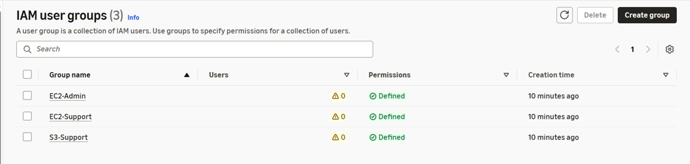

### Add users to their groups

On the **S3-Support** group's **Users** tab, choose **Add users**, select `user-1`, and confirm the assignment. Repeat for `user-2` in **EC2-Support** and `user-3` in **EC2-Admin**.

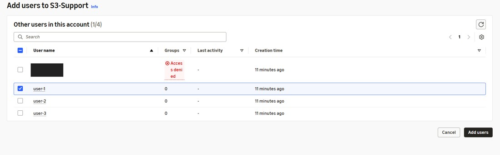

Confirm each assignment on the group's **Users** tab. The screenshots show `user-1` in **S3-Support** and `user-2` in **EC2-Support**.

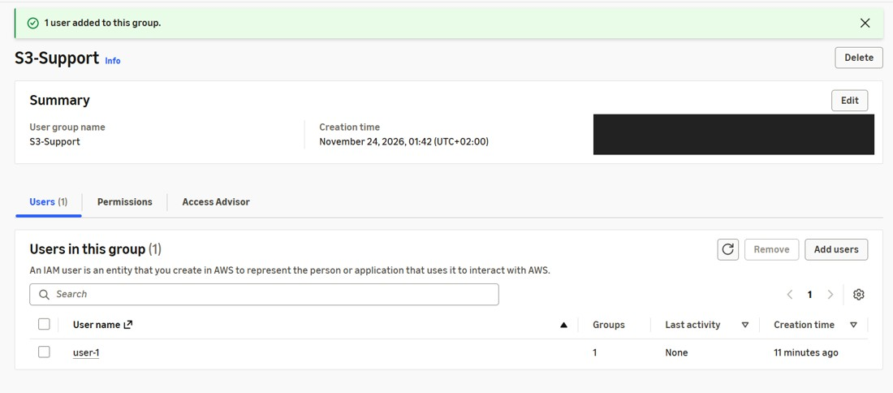

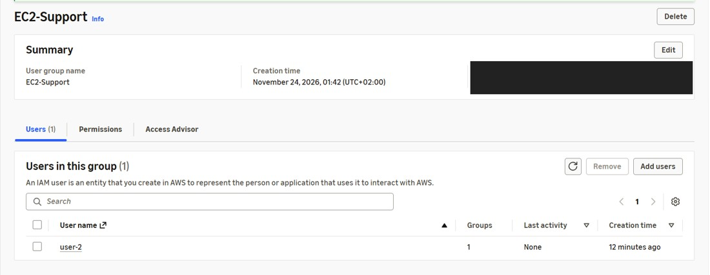

### Sign in as a lab user

Open the IAM user sign-in page in a private browser window. Use the lab-provided sign-in details and sign out between user tests.

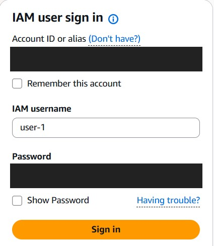

The IAM dashboard summarizes the account's IAM resources and shows where to find the IAM user sign-in URL.

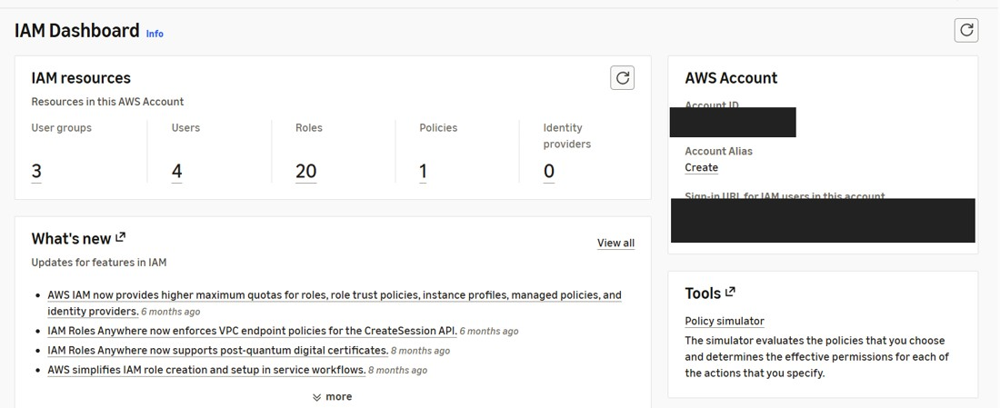

## Verify permissions

### S3-Support read-only access

Sign in as `user-1` and open **Amazon S3** to check read-only access. The S3 evidence above shows the group assignment.

### Regional SCP denial

An EC2 instance listing request outside the lab's supported Region was denied by an AWS Organizations service control policy (SCP). An explicit SCP deny takes precedence over an IAM allow. Switching to **N. Virginia (`us-east-1`)** allowed the EC2 tests to proceed.

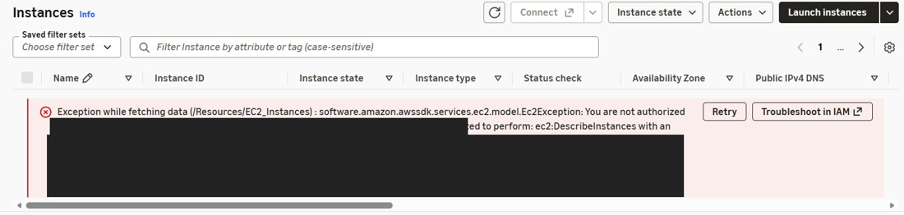

### EC2-Support stop request denied

As `user-2` in **N. Virginia**, open **EC2 → Instances**, select **LabHost**, and choose **Instance state → Stop instance**. The console opens the confirmation dialog.

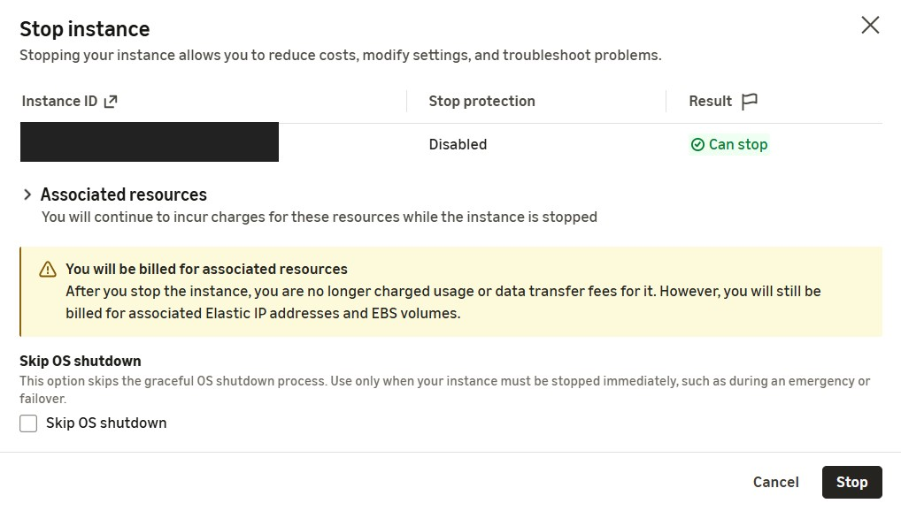

After submission, AWS denies the request because the support user's identity policy does not allow `ec2:StopInstances`.

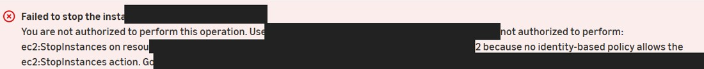

### EC2-Admin stop request succeeds

Sign in as `user-3`, return to **N. Virginia**, and submit the stop request for **LabHost**.

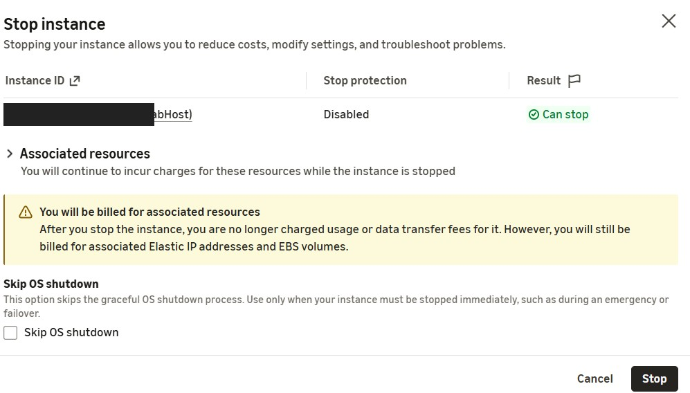

EC2 accepts the request and shows **LabHost** as **Stopping**.

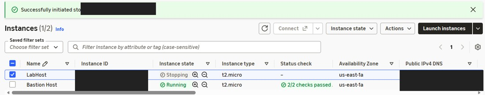

The final instance list shows **LabHost** as **Stopped** and **Bastion Host** as **Running**.

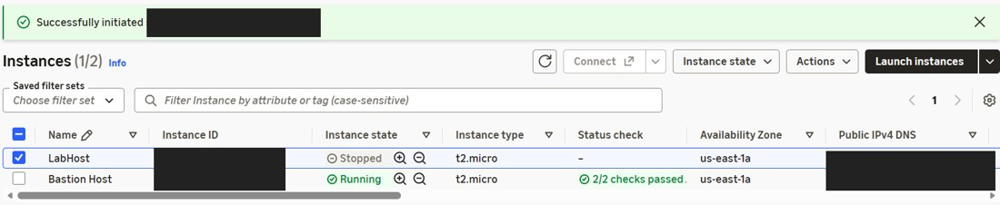

## Security takeaways

- Grant access through groups aligned with job duties and limit write actions to identities that need them.
- Test both permitted and denied actions using the identity that will actually perform them.
- Keep credentials and account-specific console details out of public documentation.
