# Introduction to Amazon EC2

This lab deploys an Apache web server on Amazon EC2 and covers instance monitoring, HTTP access, resizing, service quotas, and stop protection.

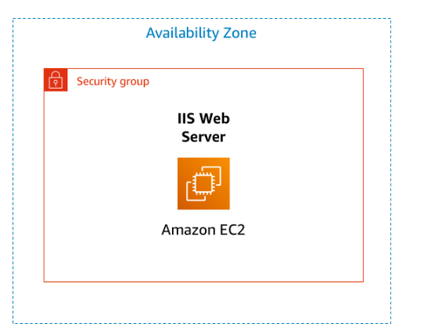

*Lab reference diagram. The diagram labels the web server as IIS. This walkthrough uses Apache HTTP Server on Amazon Linux 2023.*

**Result.** After restarting as a `t2.small`, the instance passed both EC2 status checks and served **Hello From Your Web Server!** at its new public IPv4 address.

## 1. Launch the web server

Launch an instance named **Web Server** using the following lab settings.

| Setting | Lab configuration |
| --- | --- |
| AMI | Amazon Linux 2023 |
| Instance type | `t2.micro` |
| Key pair | `vockey` |
| Network | Lab VPC / PublicSubnet1 |
| Termination protection | Enable under **Advanced details** |

Under **User data**, enter the following script to install Apache, enable it at boot, start it, and create the test page.

```bash
#!/bin/bash
dnf install -y httpd
systemctl enable httpd
systemctl start httpd
echo '<html><h1>Hello From Your Web Server!</h1></html>' > /var/www/html/index.html
```

**Evidence.** The EC2 console shows **Web Server** running as a `t2.micro` with `2/2 checks passed`. The console capture and system log also show Amazon Linux 2023 and `vockey`. Termination protection is a launch instruction whose saved state is unverified.

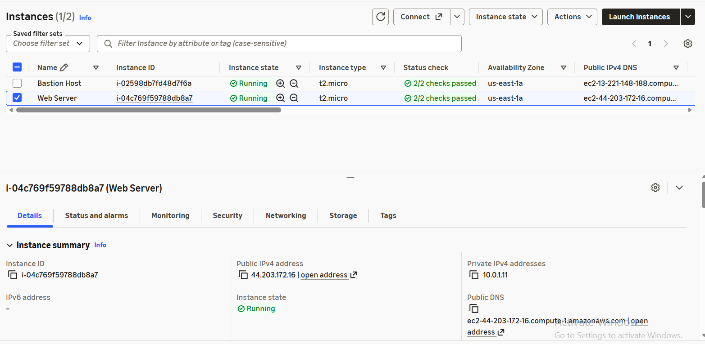

## 2. Monitor the instance

1. In the EC2 console, open **Instances** and select **Web Server**. Confirm that the instance is **Running** and that **Status check** shows **2/2 checks passed**. The instance list in Step 1 shows this result.

2. Open the **Monitoring** tab. Review **CPU utilization**, **Network in**, and **Network out**. The screenshot shows metrics for the selected one-hour window with detailed monitoring disabled.

   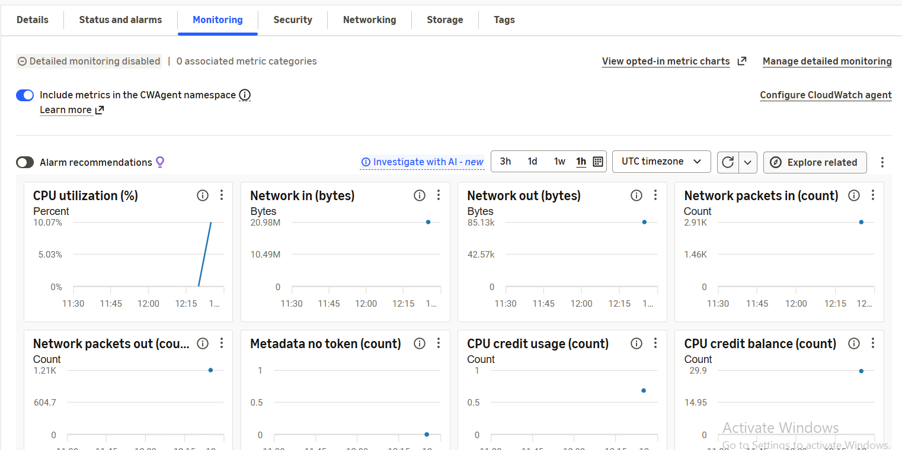

3. Select **Actions** → **Monitor and troubleshoot** → **Get system log**. Review the boot output for cloud-init messages. The captured log shows Apache package installation and the symlink created when the `httpd` service was enabled.

   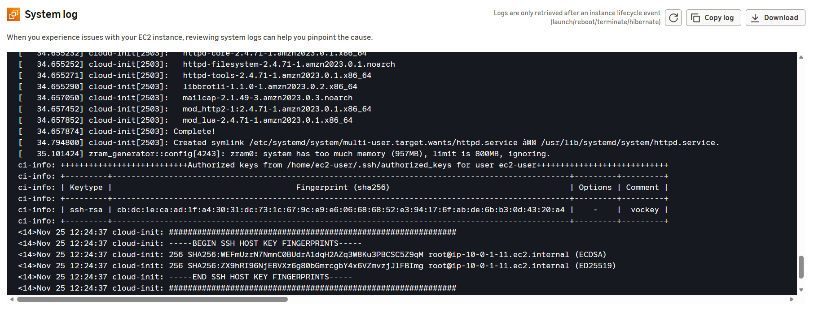

4. Select **Actions** → **Monitor and troubleshoot** → **Get instance screenshot**. Inspect the console capture for the operating system and boot state. The screenshot shows the **Amazon Linux 2023** login prompt.

   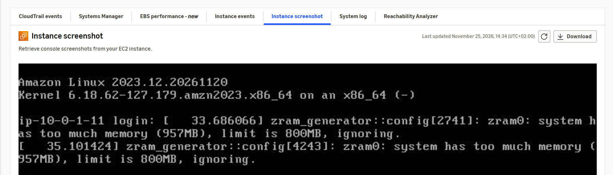

## 3. Allow HTTP and test the page

The first browser request timed out while the web server’s security group had no inbound rules. Edit the group to allow **HTTP** on **TCP port 80** from **Anywhere-IPv4** (`0.0.0.0/0`) and save the rule. Open the instance’s public IPv4 address over HTTP.

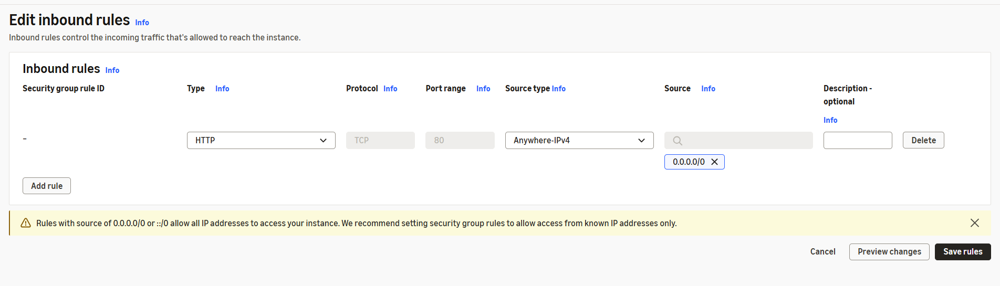

**Verified result.** The browser displayed the expected Apache test page before the resize.

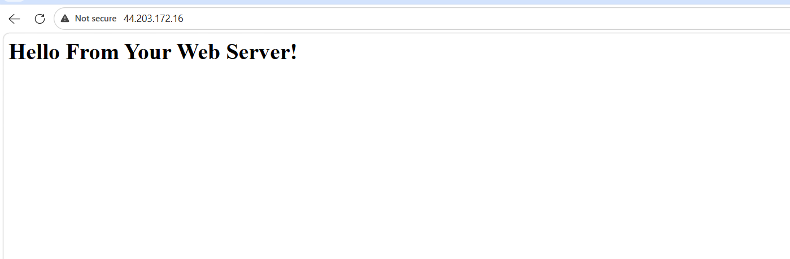

## 4. Resize the instance and root volume

Stop **Web Server** and change its instance type from `t2.micro` to `t2.small`. In the root EBS volume’s **Modify volume** screen, change the size from **8 GiB** to **10 GiB**, then start the instance and retest HTTP using its current public IPv4 address.

**Storage evidence.** The **Storage** tab showed an attached 8 GiB root volume. The modification form shows 10 GiB entered for that volume. The applied volume size and filesystem capacity are unverified.

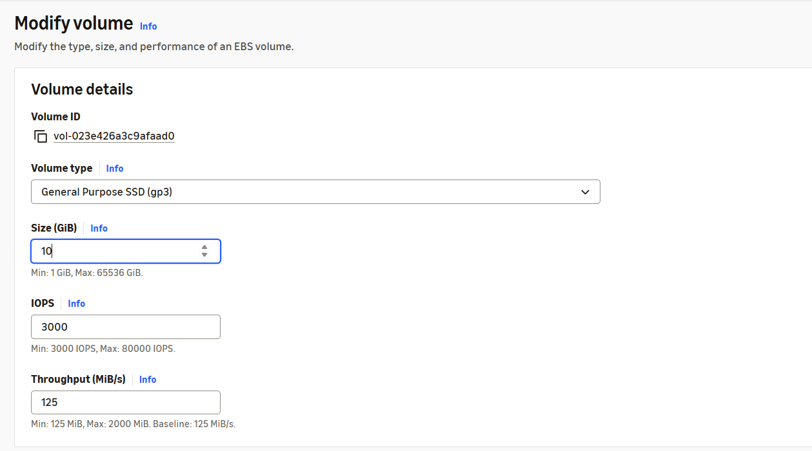

**Verified compute result.** After restart, **Web Server** was running as a `t2.small` with `2/2 checks passed`. The page loaded at the new public IPv4 address.

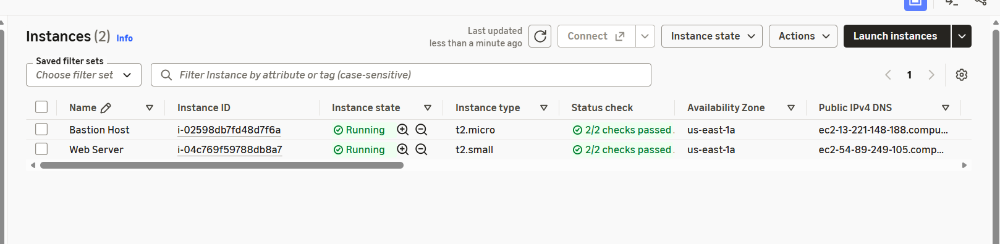

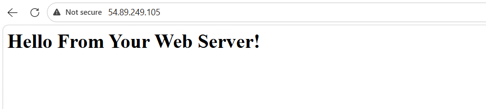

## 5. Review EC2 service quotas

In **Service Quotas**, select **Amazon Elastic Compute Cloud (Amazon EC2)** and filter for `running on-demand`. The console shows the matching quotas and their applied account-level values, AWS defaults, and utilization.

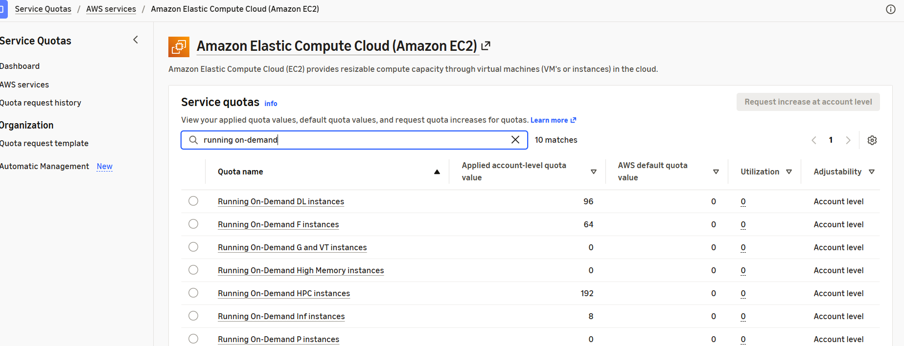

## 6. Test stop protection

With stop protection enabled, a stop attempt was rejected. The console identified the `disableApiStop` instance attribute.

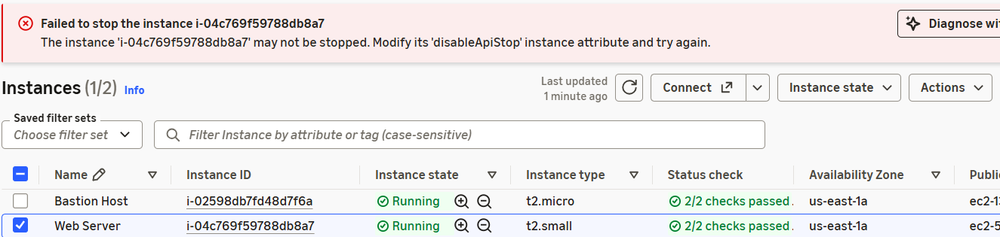

After clearing **Enable** in **Change stop protection**, the next stop request was accepted and the instance entered **Stopping**. The final **Stopped** state was unverified.

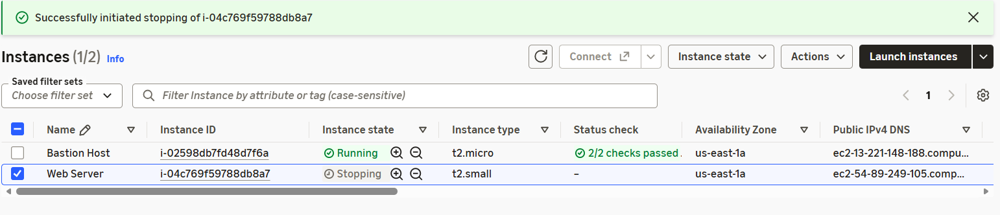

## Submission

Submission and grading are unverified in the supplied screenshots.
