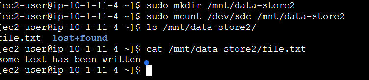
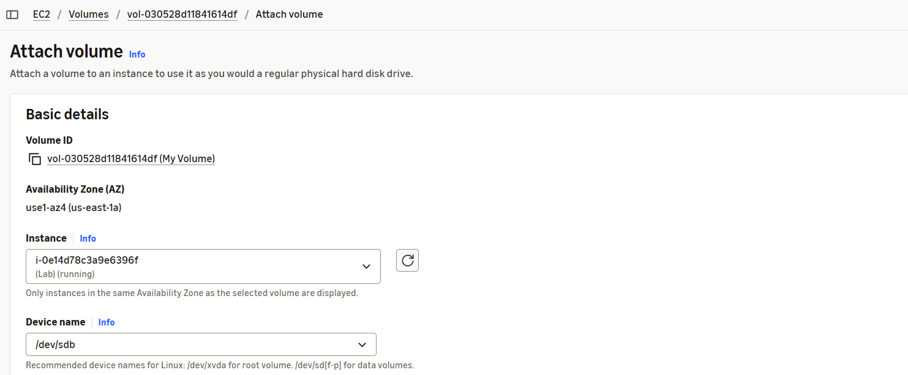
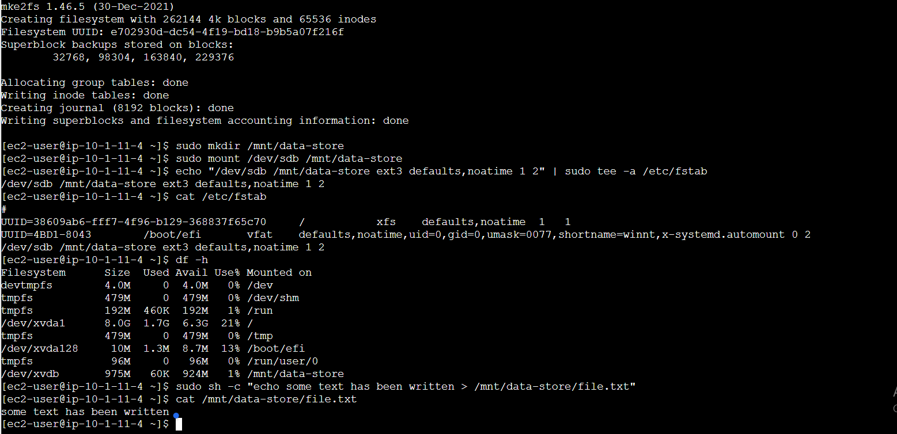
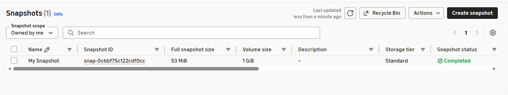
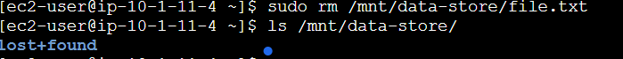
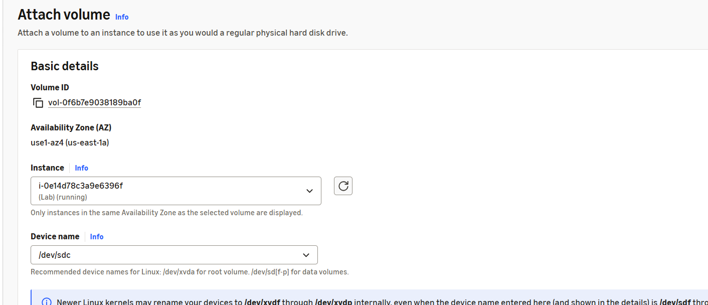

# Working with Amazon EBS


This lab demonstrates point-in-time recovery for an Amazon EC2 data volume. It provisions a 1 GiB EBS volume, writes a test file, takes a snapshot, and checks that the file can be read from a separate restored volume after deletion from the original.

## Recovery result

After deletion, the original mount at `/mnt/data-store` listed only `lost+found`. On the restored mount at `/mnt/data-store2`, `ls` listed `file.txt` and `cat` returned `some text has been written`, matching the original readback.



## Lab workflow

### 1. Create the EBS volume

In **EC2 → Volumes**, create a **1 GiB General Purpose SSD (gp2)** volume and tag it `Name=My Volume`. Use the same Availability Zone as the **Lab** instance, **us-east-1a** in this run. The creation capture confirms that EC2 created **My Volume** as a 1 GiB gp2 volume.

### 2. Attach the volume to EC2

Select **My Volume**, choose **Attach volume**, and select **Lab** with device name `/dev/sdb`. The attachment form shows the chosen instance and device in `us-east-1a`. A later volume details capture shows **In-use**.



### 3. Connect with Session Manager

From the **Lab** instance, choose **Connect → Session Manager → Connect**, then switch to the Linux lab user.

```bash
sudo su -l ec2-user
lsblk
```

The terminal confirms the switch to `ec2-user` and identifies the 1 GiB data disk as `xvdb`. The Session Manager connection screen is outside the captured evidence.

### 4. Format, mount, and write a test file

After identifying the new 1 GiB data disk with `lsblk`, format it as ext3 and mount it at `/mnt/data-store`. Add the mount to `/etc/fstab` for startup and write a test file.

```bash
sudo mkfs -t ext3 /dev/sdb
sudo mkdir /mnt/data-store
sudo mount /dev/sdb /mnt/data-store
echo "/dev/sdb /mnt/data-store ext3 defaults,noatime 1 2" | sudo tee -a /etc/fstab
cat /etc/fstab
df -h
sudo sh -c "echo some text has been written > /mnt/data-store/file.txt"
cat /mnt/data-store/file.txt
```

The [formatting capture](screenshots/format-ext3.png) shows successful filesystem creation. The terminal below shows the `fstab` entry, `/dev/xvdb` mounted at `/mnt/data-store`, and the original file contents. The startup mount was configured. A reboot test is unverified.



### 5. Create the snapshot and delete the original test file

From **My Volume**, choose **Create snapshot**, set `Name=My Snapshot`, and wait for **Completed**. The Snapshots list shows **My Snapshot** completed for a 1 GiB volume.



Delete the test file from the source mount and check its directory listing.

```bash
sudo rm /mnt/data-store/file.txt
ls /mnt/data-store/
```



### 6. Restore the snapshot and verify the file

From **My Snapshot**, choose **Create volume from snapshot**. Use `us-east-1a`, set `Name=Restored Volume`, and attach the new volume to **Lab** as `/dev/sdc`.

The volume creation form shows the **Restored Volume** tag. The attachment capture shows **Lab**, `us-east-1a`, and `/dev/sdc`. The restored volume's source snapshot ID is outside the captured evidence.



Mount the restored filesystem directly and check the recovered file.

```bash
sudo mkdir /mnt/data-store2
sudo mount /dev/sdc /mnt/data-store2
ls /mnt/data-store2/
cat /mnt/data-store2/file.txt
```

The [recovery result](#recovery-result) shows both the recovered filename and its contents.

