# AWS Elastic Load Balancing and EC2 Auto Scaling Lab

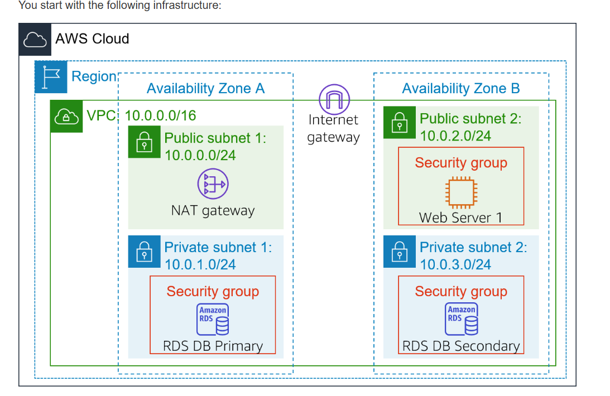

*Starting architecture.* One EC2 instance, **Web Server 1**, runs in a public subnet. The diagram shows an existing VPC with public and private subnets in two Availability Zones and an Amazon RDS database tier in the private subnets.

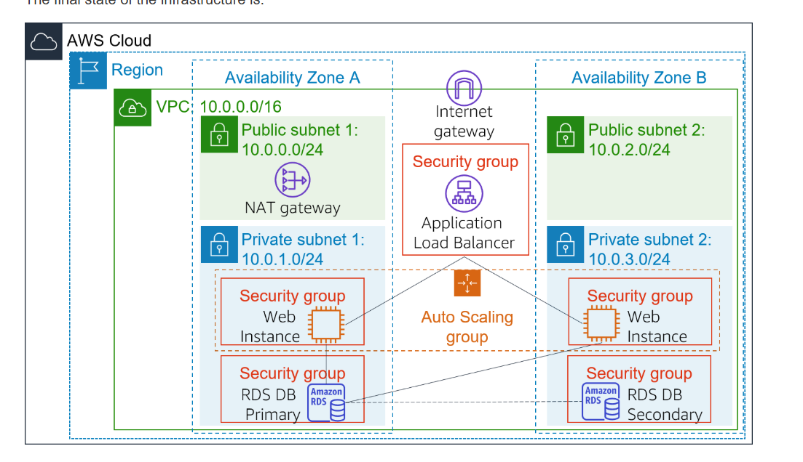

*Target architecture.* An internet-facing Application Load Balancer (ALB) routes requests to EC2 web instances that an Auto Scaling group manages across two private subnets. The diagrams are ordered from starting state to target state. Their source files were the two newest in the capture folder by both creation and last-modified time.

## What I built and tested

I used the original EC2 web server as the basis for an AMI and launch template, then set up the web tier behind an internet-facing Application Load Balancer. I configured the Auto Scaling group to target 50% average CPU utilization, with a capacity range of two to six instances.

I verified that the application opened through the load balancer and that the target group reported two healthy instances. The CloudWatch capture shows the CPU alarm firing during the load-test sequence. A later EC2 screenshot shows four running lab instances, which is consistent with scale-out. The Auto Scaling activity history would be needed to confirm what triggered the additional launches.

## Objective

Move the web tier from a standalone server to a load-balanced pool of EC2 instances and observe its response to CPU load. The request path is **client → LabELB → LabGroup → EC2 web instance**. The RDS tier appears in both architecture diagrams.

## Setup

### Amazon Machine Image

Use **Web Server 1** as the source for **WebServerAMI**, a reusable image of the lab web server. The screenshot shows the image creation form.

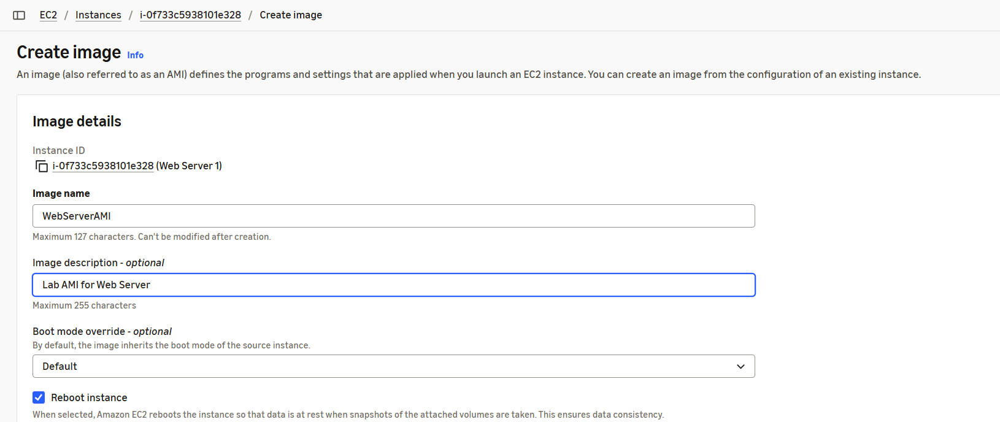

### Target group

Create **LabGroup** with EC2 instances as targets and **HTTP on port 80**. The initial target group view shows zero registered targets.

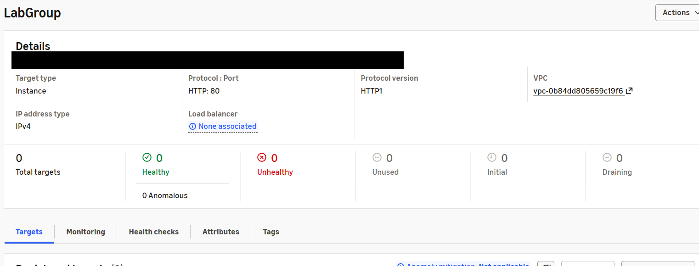

### Application Load Balancer

Configure **LabELB** as an internet-facing Application Load Balancer across two Availability Zones, with **LabGroup** as the backend target group. The load balancer list shows **LabELB** as **Active**, and the later target health view confirms the target group association.

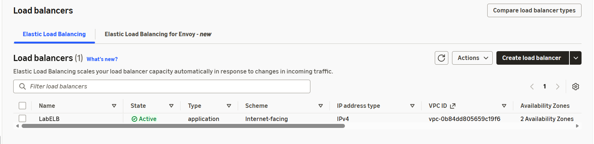

### EC2 launch template

Use **LabConfig** to define the settings for new web instances. The template summary shows the lab web server AMI, the **t2.micro** instance type, and **Web Security Group**.

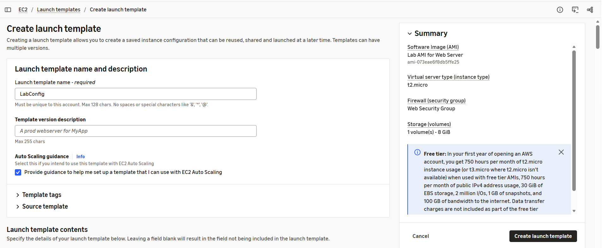

### Auto Scaling group

Configure **Lab Auto Scaling Group** with **LabConfig** and the **LabGroup** target group. The scaling setup shows a minimum capacity of **2**, a maximum of **6**, and a target tracking policy named **LabScalingPolicy** with a **50% average CPU utilization** target and **300-second instance warmup**.

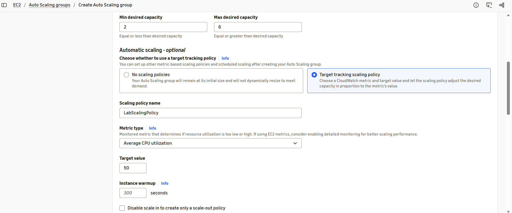

## Validation

### Healthy targets and application access

The **LabGroup** console shows **2 of 2 targets healthy** with **LabELB** associated. Opening the load balancer endpoint returned the lab web page, which displayed the responding instance's metadata and **0% current CPU load** at capture time.

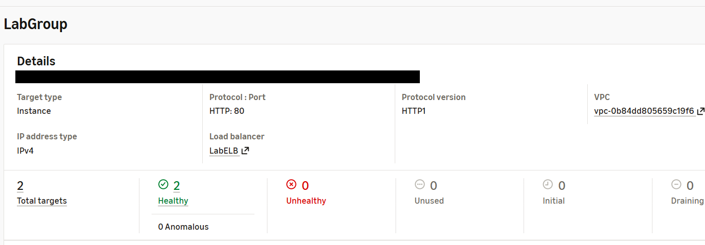

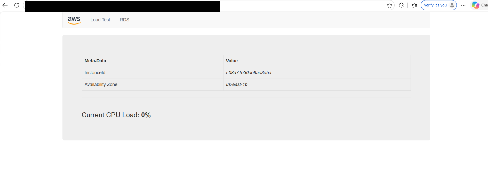

### Load test and CloudWatch

The lab page provides a **Load Test** control. The later CloudWatch capture shows **CPUUtilization** rising above the **50%** threshold and the target tracking high alarm entering **In alarm**.

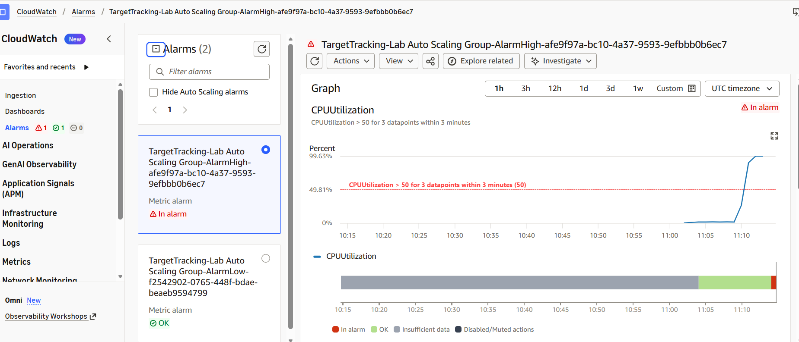

### Scale-out evidence

The baseline target group view shows two registered instances. After the alarm capture, the EC2 console shows **four running instances named Lab Instance** in addition to the bastion host and the original web server. One of the four is still initializing its EC2 status checks. This is consistent with scale-out. The exact scaling activity and the later target health of the additional instances remain unverified.

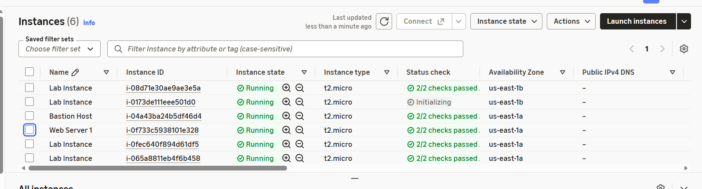
