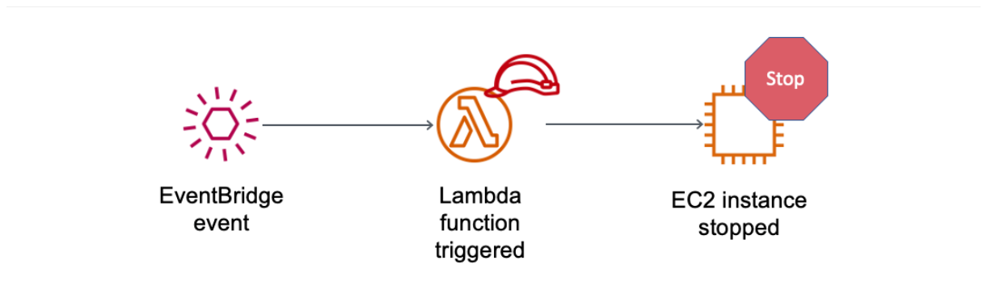
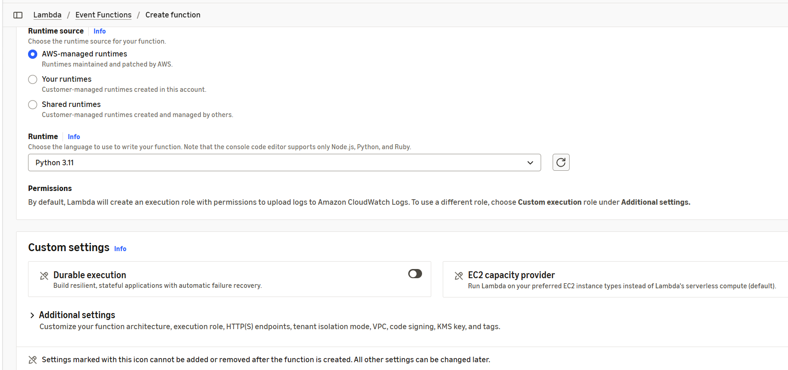
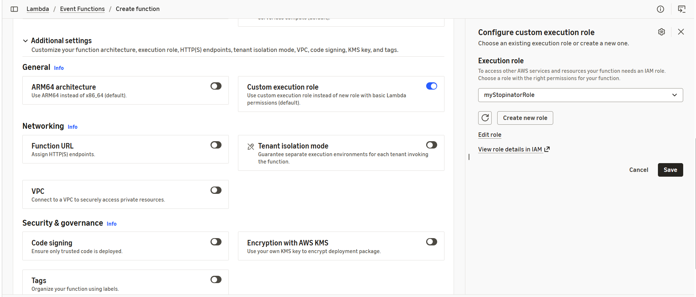
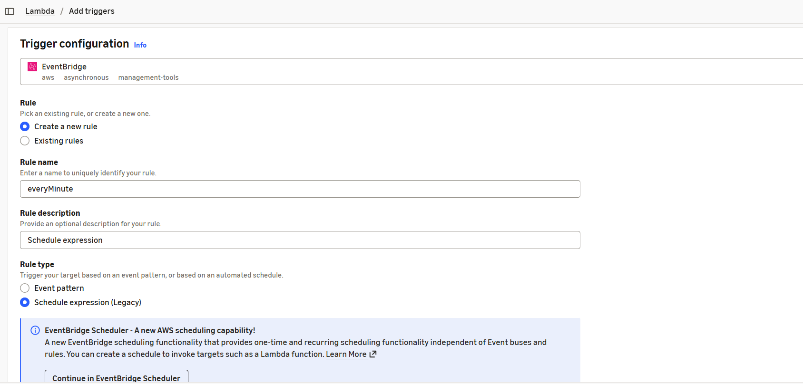
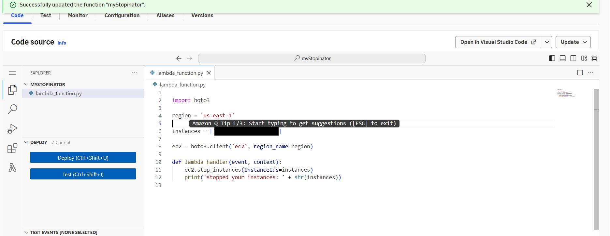
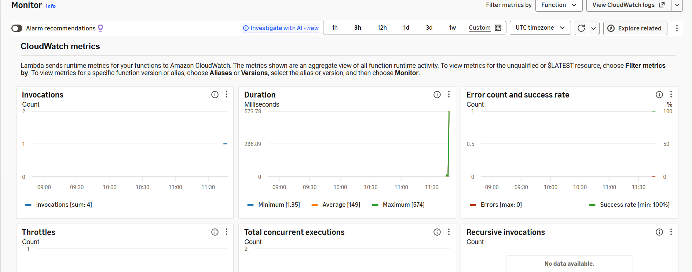
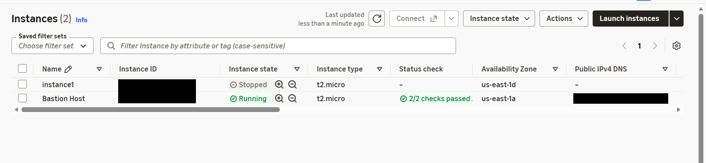

# AWS Lambda Lab — Scheduled EC2 Stop

The `myStopinator` Lambda function uses `boto3` to stop a designated EC2 instance in `us-east-1`. The lab uses the EventBridge rule `everyMinute` with `rate(1 minute)` to invoke the function on a recurring schedule.

## Lambda setup

The function uses the AWS-managed **Python 3.11** runtime and the existing IAM execution role **`myStopinatorRole`**.

## EventBridge trigger

In Lambda's **Add trigger** form, the lab used EventBridge with a new rule named `everyMinute` and selected **Schedule expression (Legacy)**. The lab's schedule expression is `rate(1 minute)`. The screenshot captures the rule name and type, with the rate field below the visible area.

## EC2 stop automation and deployment

The `lambda_function.py` handler uses a `boto3` EC2 client configured for `us-east-1`. Each invocation calls `ec2.stop_instances(InstanceIds=instances)` for the configured instance ID list. After the API call returns, the handler prints the requested IDs.

The code was deployed from the Lambda console. The deployment screenshot shows the successful update banner and the editor's **Current** status.

## Monitoring and verification

The Lambda **Monitor** tab showed four invocations, zero reported errors, and a 100% success rate for the displayed CloudWatch metrics window.

The EC2 console captured the target instance, `instance1`, in the **Stopped** state. The **Bastion Host** was **Running** in the same view.

